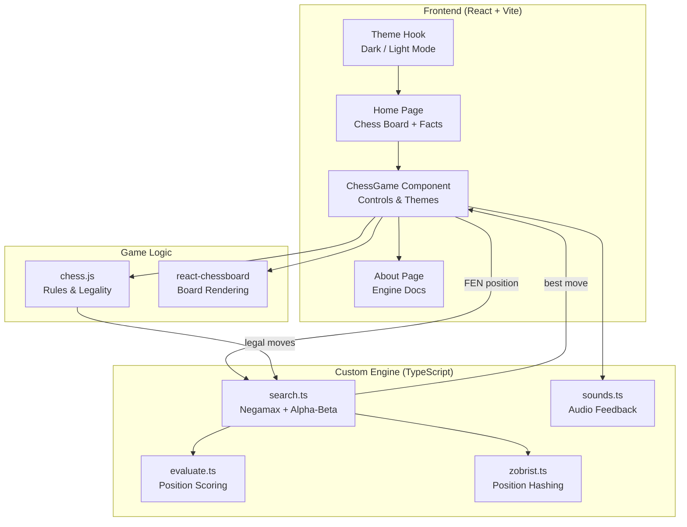
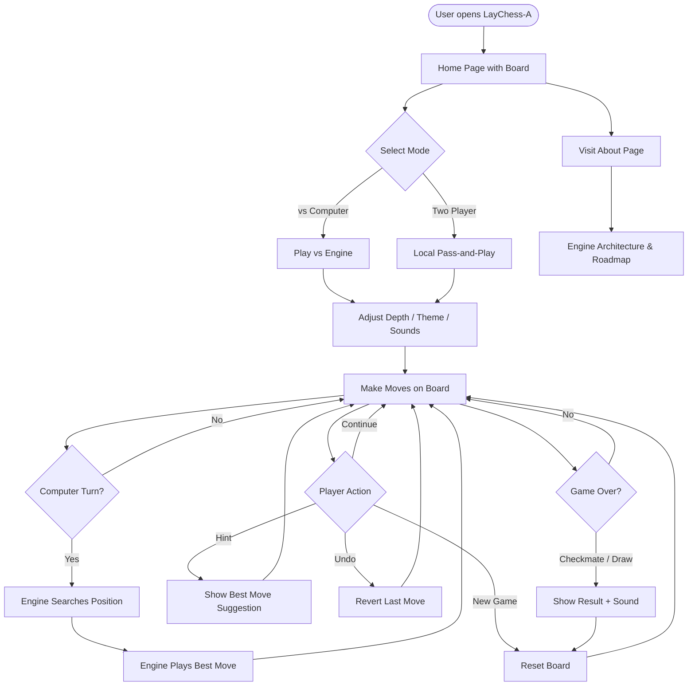
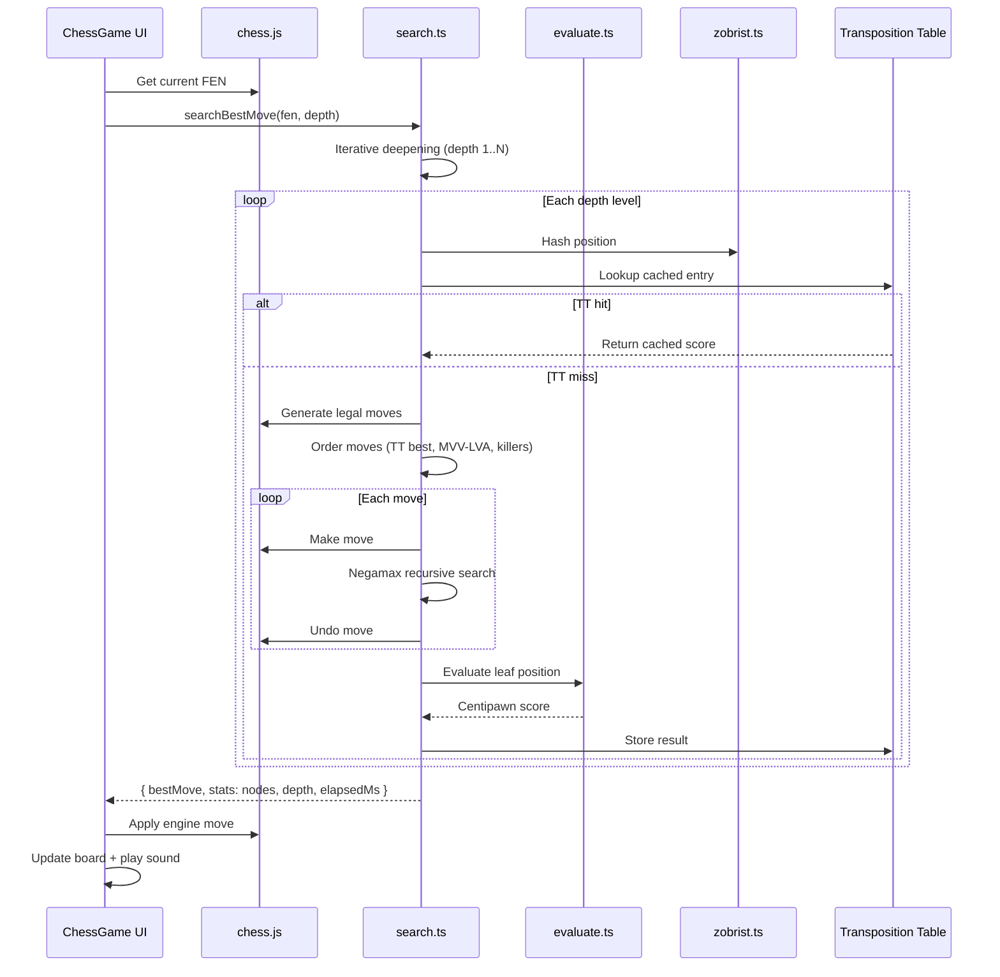

# LayChess-A

> **A Chess App for Champs — Play Sharp. Think Deeper. Win Cleaner.**

A browser-native chess application with a **custom TypeScript engine** built from scratch. Play against the computer or a friend, tune search depth, explore engine architecture, and experience competitive chess with zero install — entirely client-side.

**Developed by [Pawani Sharma](https://github.com/pawani-2502)**

---

## Table of Contents

- [Problem Statement](#problem-statement)
- [Solution](#solution)
- [Key Features](#key-features)
- [System Architecture](#system-architecture)
- [User Flow](#user-flow)
- [Engine Search Flow](#engine-search-flow)
- [Tech Stack](#tech-stack)
- [Project Structure](#project-structure)
- [Chess Engine Overview](#chess-engine-overview)
- [Getting Started](#getting-started)
- [Environment Variables](#environment-variables)
- [Available Scripts](#available-scripts)
- [Deployment](#deployment)
- [Screenshots](#screenshots)
- [Future Roadmap](#future-roadmap)
- [Contributing](#contributing)
- [License](#license)
- [Author](#author)

---

## Problem Statement

Most online chess apps either rely on **cloud-based engines** (latency, privacy concerns) or offer **weak in-browser opponents** with no transparency into how moves are chosen. Champions and learners need something better:

- No dependency on external servers for engine moves
- A **real search algorithm** — not random or shallow heuristics
- **Adjustable difficulty** via search depth control
- **Premium board experience** — themes, sounds, hints, undo
- **Educational transparency** — understand negamax, alpha-beta, and transposition tables
- **Instant access** — open a tab and play, no download required

**LayChess-A** delivers a championship-grade browser experience with a hand-written engine that runs entirely in TypeScript.

---

## Solution

LayChess-A is a **client-side chess platform** that:

1. Renders a polished interactive board with `react-chessboard` and `chess.js` for rules
2. Runs a **custom negamax engine** with alpha-beta pruning in a Web Worker–free main thread
3. Lets players choose **vs Computer** or **local two-player** mode
4. Offers **5 board themes**, optional 3D tilt, move sounds, hints, and undo
5. Exposes an **About page** documenting architecture, engine techniques, and performance
6. Deploys as a **static SPA** — Vercel-ready with zero backend

---

## Key Features

| Feature | Description |
|---------|-------------|
| **Custom TypeScript Engine** | Hand-written negamax search with alpha-beta pruning, quiescence, and iterative deepening |
| **Transposition Table** | Zobrist hashing caches searched positions for massive speedups |
| **Move Ordering** | MVV-LVA captures + killer move heuristic for earlier cutoffs |
| **Play vs Computer** | Adjustable search depth (default 3) — deeper = stronger but slower |
| **Local Two-Player** | Pass-and-play on the same device |
| **Move Hints** | Engine suggests the best move when you're stuck |
| **Board Themes** | 5 premium themes — Warm Paper, Emerald Club, Midnight, Rose Marble, Slate Stone |
| **3D Board Tilt** | Optional perspective tilt for immersive play |
| **Move Sounds** | Audio feedback for moves, captures, checks, and game end |
| **Undo & New Game** | Full game control without page reload |
| **Dark / Light Mode** | Theme persistence via local storage |
| **Chess Facts** | Educational history section on the home page |
| **About Page** | Architecture layers, engine tech, performance metrics, roadmap |
| **Zero Backend** | 100% client-side — no server, no API keys required |

---

## System Architecture



---

## User Flow



---

## Engine Search Flow



---

## Tech Stack

| Layer | Technologies |
|-------|-------------|
| **Frontend** | React 19, TypeScript, Vite 7, Tailwind CSS 4, Radix UI |
| **Routing** | React Router DOM 7 |
| **Chess Rules** | [chess.js](https://github.com/jhlywa/chess.js) |
| **Board UI** | [react-chessboard](https://github.com/Clariity/react-chessboard) |
| **Engine** | Custom TypeScript — negamax, alpha-beta, quiescence, iterative deepening |
| **Hashing** | Zobrist hashing with transposition table |
| **Tooling** | ESLint, Prettier, TypeScript ESLint |
| **Deployment** | Static SPA — Vercel, Netlify, or any static host |

---

## Project Structure

```
LAYCHESS-A/
├── src/
│   ├── components/
│   │   ├── ChessGame.tsx          # Main board, controls, engine integration
│   │   ├── about/                 # About page sections (architecture, roadmap, dev)
│   │   ├── layout/                # SiteHeader, PageShell
│   │   └── ui/                    # Button, Slider, Switch, Dropdown, Sonner
│   ├── lib/
│   │   ├── chess-ai/
│   │   │   ├── search.ts          # Negamax + alpha-beta + iterative deepening
│   │   │   ├── evaluate.ts        # Material, PST, mobility, king safety
│   │   │   ├── zobrist.ts         # Position hashing
│   │   │   └── sounds.ts          # Move/capture/check audio
│   │   ├── site.ts                # Site metadata & developer info
│   │   └── utils.ts               # Tailwind class merge utility
│   ├── routes/
│   │   ├── index.tsx              # Home — play + chess history facts
│   │   └── about.tsx              # About page route
│   ├── hooks/
│   │   └── use-theme.ts           # Dark/light theme persistence
│   ├── App.tsx                    # Router setup
│   └── main.tsx                   # Entry point
├── vercel.json                    # SPA catch-all rewrite
├── vite.config.ts
└── README.md                      # You are here
```

---

## Chess Engine Overview

### Search Algorithms

| Algorithm | Purpose |
|-----------|---------|
| **Negamax** | Unified minimax framework — single recursive function for both sides |
| **Alpha-Beta Pruning** | Eliminates branches that cannot improve the best score |
| **Quiescence Search** | Extends leaf-node search through capture sequences (prevents horizon effect) |
| **Iterative Deepening** | Searches depth 1, 2, 3… improving move ordering each pass |

### Optimizations

| Technique | Purpose |
|-----------|---------|
| **Zobrist Hashing** | O(1) incremental position keys for transposition table |
| **Transposition Table** | Caches depth, score, flag (EXACT/LOWER/UPPER), and best move |
| **Killer Move Heuristic** | Prioritizes quiet moves that caused beta cutoffs at the same ply |
| **MVV-LVA Ordering** | Orders captures by Most Valuable Victim, Least Valuable Attacker |

### Evaluation Function

The static evaluator scores positions using:

- **Material balance** — standard piece values (P=1, N/B=3, R=5, Q=9)
- **Piece-square tables** — positional bonuses for piece placement
- **Mobility** — reward for available legal moves
- **King safety** — penalties for exposed kings

All scores returned in **centipawns** from White's perspective.

---

## Getting Started

### Prerequisites

- **Node.js** 18 or higher
- **npm** 9+ (comes with Node.js)

### Installation

**1. Clone the repository**

```bash
git clone https://github.com/pawani-2502/LAYCHESS-A.git
cd LAYCHESS-A
```

**2. Install dependencies**

```bash
npm install
```

**3. Start the development server**

```bash
npm run dev
```

Open the URL Vite prints (usually **http://localhost:5173**).

| Page | URL |
|------|-----|
| Play Chess | http://localhost:5173/ |
| About / Engine Docs | http://localhost:5173/about |

---

## Environment Variables

All features work out of the box with **no environment variables required**. The engine runs entirely client-side.

| Variable | Required | Description |
|----------|----------|-------------|
| `VITE_GITHUB_URL` | No | GitHub link on the About page (defaults to repo URL in code) |
| `VITE_PORTFOLIO_URL` | No | Portfolio link on the About page |

---

## Available Scripts

| Command | Description |
|---------|-------------|
| `npm run dev` | Start Vite development server |
| `npm run build` | Production build to `dist/` |
| `npm run preview` | Preview the production build locally |
| `npm run lint` | Run ESLint across the project |
| `npm run format` | Format code with Prettier |

---

## Deployment

LayChess-A is a **static single-page application**. Build and deploy to any static host:

```bash
npm run build
```

`vercel.json` includes a catch-all rewrite for client-side routing (`/about` works on refresh).

| Platform | Steps |
|----------|-------|
| **Vercel** | Connect repo → auto-deploys on push |
| **Netlify** | `npm run build` → publish `dist/` |
| **GitHub Pages** | Build → deploy `dist/` to `gh-pages` branch |

No server, database, or API keys needed.

---

## Screenshots

| Play vs Computer | Board Themes | Engine Depth Control |
|:---:|:---:|:---:|
| _Challenge the custom engine_ | _5 premium board styles_ | _Tune difficulty 1–6_ |

| Move Hints | About Page | Dark Mode |
|:---:|:---:|:---:|
| _Best-move suggestions_ | _Engine architecture docs_ | _Light & dark themes_ |

---

## Future Roadmap

- [ ] Multiplayer over WebSocket (real-time online play)
- [ ] Opening explorer with master game database
- [ ] Analysis board with evaluation bar and best-move arrows
- [ ] ELO rating system and ranked matchmaking
- [ ] Tournament mode (Swiss / round-robin)
- [ ] PGN import/export for game review
- [ ] Mobile-optimized touch controls
- [ ] Web Worker offload for deeper search without UI jank

---

## Contributing

Contributions are welcome! To contribute:

1. Fork the repository
2. Create a feature branch: `git checkout -b feature/your-feature`
3. Commit your changes: `git commit -m "Add your feature"`
4. Push to the branch: `git push origin feature/your-feature`
5. Open a Pull Request

Please run `npm run lint` before submitting.

---

## License

Private project — all rights reserved.

---

## Author

**Pawani Sharma**

Full-Stack Developer passionate about chess engines, performance optimization, and polished browser experiences.

- GitHub: [@pawani-2502](https://github.com/pawani-2502)

---

<p align="center">
  <strong>LayChess-A</strong> — A chess app for champs. Play sharp. Think deeper. Win cleaner.
  <br />
  Built with ♟️ by <a href="https://github.com/pawani-2502">Pawani Sharma</a>
</p>
